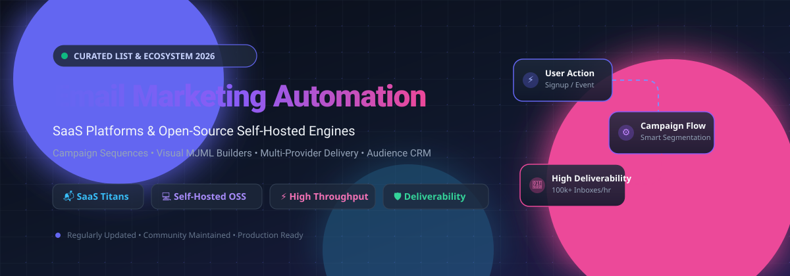

# 🚀 Awesome Email Marketing Automation    

  

  <strong>🌟 Curated Directory of Enterprise SaaS Platforms &amp; Self-Hosted Open-Source Email Marketing Automation Engines 🌟</strong> 
  <em>Focused on Campaign Workflows, Visual Builders, Omnichannel Sequences, High-Volume Deliverability &amp; Self-Hosted Infrastructure</em>

  <a href="#-sector-overview--market-dynamics">Sector Overview</a> •
  <a href="#-saas-hosted-platforms">SaaS Platforms</a> •
  <a href="#-open-source-github-projects">Open-Source Engines</a> •
  <a href="#-key-architecture-archetypes">Architectures</a> •
  <a href="#-contributing">Contributing</a> •
  <a href="#-star-history">Star History</a> •
  <a href="#-support--sponsorship">Support</a>

---

## 📈 Sector Overview & Market Dynamics

The global email marketing and marketing automation market is estimated at **$9.5 billion in 2026** and projected to reach **$17.9 billion by 2032** (growing at an ~11.2% CAGR). The sector is **moderately fragmented**; enterprise scale is anchored by multi-billion dollar titans (Intuit Mailchimp, HubSpot, and Klaviyo) dominating broad SMB and e-commerce ecosystems, while intense competition persists across specialized verticals like creator-first platforms, transactional delivery infrastructure, and privacy-preserving self-hosted open-source software.

---

## 🏢 SaaS / Hosted Platforms

Below is a breakdown of category-leading commercial email marketing platforms, sorted in descending order by enterprise scale (company valuation and market capitalization):

| Platform | Valuation / Revenue Scale | Starting Pricing | Free Tier / Free Trial Limits | Key Features & Strengths | Best For |
| :--- | :--- | :--- | :--- | :--- | :--- |
| **[Intuit Mailchimp](https://mailchimp.com/)** | ~$12B Valuation (Acquired by Intuit for $12B) | $13.00/month (Essentials tier) | Free tier: 500 contacts, 1,000 sends/month (daily limit: 500) | Drag-and-drop builder, generative AI assistant, 300+ integrations, pre-built journeys | General SMBs seeking established platform & rich ecosystem |
| **[HubSpot Email Marketing](https://www.hubspot.com/products/marketing)** | ~$30B+ Market Cap (NYSE: HUBS, $2.6B+ ARR) | $15.00/month (Marketing Hub Starter) | Free tier: 2,000 email sends/month to 1,000 contacts with HubSpot branding | Deep native CRM integration, forms, contact activity timeline, lifecycle stages | B2B businesses needing email deeply tied to CRM & pipelines |
| **[Klaviyo](https://www.klaviyo.com/)** | ~$8.5B Market Cap (NYSE: KVYO, ~$930M+ ARR) | $20.00/month (Starts at 500 contacts) | Free tier: 250 contacts, 500 email sends/month, 150 free SMS/MMS credits | Real-time predictive analytics, native Shopify/WooCommerce syncing, custom events | E-commerce brands focused on revenue attribution & automated cart flows |
| **[Constant Contact](https://www.constantcontact.com/)** | ~$3.4B (Private Equity buyout by Endurance / Clearlake) | $12.00/month (Lite plan) | 60-day free trial (US/Canada: 60 days, up to 100 contacts; no credit card required) | Event marketing & ticketing, social posting, list segmentation, survey forms | Non-profits, community groups & local businesses running events |
| **[ActiveCampaign](https://www.activecampaign.com/)** | ~$3.0B Valuation ($250M+ ARR) | $15.00/month (Starter tier, billed annually) | 14-day free trial (Full feature access, up to 100 contacts, 100 sends) | 900+ pre-built automation recipes, visual workflow builder, lead scoring, built-in CRM | Advanced marketers requiring complex conditional logic & branching |
| **[Brevo](https://www.brevo.com/)** *(formerly Sendinblue)* | ~$1.2B Valuation ($140M+ ARR) | $9.00/month (Starter tier, starts at 5,000 emails) | Free tier: 300 emails/day (~9,000/month) with unlimited contact storage | Unified email, SMS & WhatsApp campaigns, transactional SMTP API, shared team inbox | Multi-channel teams prioritizing high contact volumes with daily send limits |
| **[Campaign Monitor](https://www.campaignmonitor.com/)** | ~$1.0B (Part of Marigold group) | $11.00/month (Lite plan) | Free trial: Send campaigns to up to 5 subscribers (full UI testing) | Designer-grade templates, dynamic content per recipient, deliverability consulting | Agencies and creative teams desiring pixel-perfect visual styling |
| **[ConvertKit](https://convertkit.com/)** *(Kit)* | ~$200M+ Valuation (~$45M ARR) | $15.00/month (Creator tier) | Free tier: Up to 1,000 subscribers, unlimited email broadcasts, landing pages | Paid newsletter subscriptions, visual automation builder, creator recommendations | Bloggers, podcasters, newsletter writers & digital product creators |
| **[GetResponse](https://www.getresponse.com/)** | ~$150M+ Valuation (~$50M ARR) | $15.60/month (Email Marketing tier) | 30-day free trial (Access to all premium features, up to 1,000 contacts) | AI email generator, integrated webinar software, landing page builder, automated funnels | SMBs seeking all-in-one marketing funnels and native webinar tooling |
| **[Omnisend](https://www.omnisend.com/)** | ~$100M+ Valuation (~$40M ARR) | $16.00/month (Standard plan) | Free tier: 250 contacts, 500 emails/month, 60 international SMS credits | 1-click Shopify/BigCommerce app install, browse/cart abandonment workflows, push notifications | DTC e-commerce merchants combining multi-carrier SMS & promotional email |

---

## 💻 Open-Source GitHub Projects

Curated self-hosted marketing platforms, newsletter engines, and delivery infrastructures. Badges display real-time GitHub stargazers and link directly to stargazers pages. Sorted in descending order by GitHub stars:

| Project | Stars | Primary Architecture | Core Capabilities | Deployment |
| :--- | :--- | :--- | :--- | :--- |
| **[Novu](https://github.com/novuhq/novu)** |  | Node.js / NestJS / Redis / MongoDB | Unified notification workflow orchestration across Email, SMS, Push, Chat, and In-App inbox components | Docker, Helm, Cloud |
| **[Listmonk](https://github.com/knadh/listmonk)** |  | Go / PostgreSQL (Single Binary) | High-performance newsletter engine sending millions of emails with minimal CPU/RAM (~57MB), SQL-based segmentation, Go templating | Single Binary, Docker |
| **[Postal](https://github.com/postalserver/postal)** |  | Ruby / MariaDB / RabbitMQ | Enterprise mail delivery platform for incoming & outgoing email; self-hosted alternative to SendGrid and Amazon SES | Docker Compose |
| **[BillionMail](https://github.com/Billionmail/BillionMail)** |  | Go / Shell / Docker | Full mail server, high-volume newsletter and outbound email marketing engine free from per-contact SaaS fees | Docker |
| **[Mautic](https://github.com/mautic/mautic)** |  | PHP (Symfony) / MySQL | Most complete open-source marketing automation alternative to HubSpot; visual campaign builder, lead scoring, CRM, landing pages | Docker, Bare-metal LAMP |
| **[Plunk](https://github.com/useplunk/plunk)** |  | TypeScript / AWS SES / Prisma | Modern developer-focused email platform built with AWS SES, visual journey workflows, dynamic contacts, and transactional APIs | Docker, Vercel/Node |
| **[Dittofeed](https://github.com/dittofeed/dittofeed)** |  | TypeScript / Temporal / ClickHouse | Customer engagement & automated behavioral journeys engine, cross-channel messaging across email, SMS, push, and webhooks | Docker Compose |
| **[Notifuse](https://github.com/Notifuse/notifuse)** |  | Go / React / PostgreSQL | Newsletter & transactional email platform featuring a visual MJML builder, multi-provider SMTP failover, and workspace isolation | Docker, Railway |
| **[Keila](https://github.com/pentacent/keila)** |  | Elixir / Phoenix / PostgreSQL | Clean, privacy-friendly Mailchimp alternative with block editor, double opt-in, tag segmentation, and per-sender SMTP configurations | Docker, Railway |
| **[SendPortal](https://github.com/mettle/sendportal)** |  | PHP (Laravel) / MySQL | Self-hosted email marketing and newsletter management software; seamlessly connects with Amazon SES, SendGrid, Mailgun, and Postmark | Docker, Laravel Forge |
| **[NetSendo](https://github.com/NetSendo/NetSendo)** |  | PHP (Laravel) / Vue.js / Reverb | Self-hosted email & SMS marketing automation platform with real-time analytics, CRM workflows, and LLM integrations | Docker Compose |

---

## 🏛️ Key Architecture Archetypes

Understanding the differentiation between open-source components prevents operational surprises:

1. **Full Marketing Automation Platforms (e.g., Mautic, NetSendo)**:
   - Provide complete behavioral lead scoring, multi-tier funnel triggers, CRM sync, forms, and landing pages.
   - Ideal when your goal is replacing HubSpot or ActiveCampaign.
2. **Newsletter & Campaign Broadcast Engines (e.g., Listmonk, Keila, SendPortal, Notifuse)**:
   - Optimized for fast sending, subscriber segmentation, and newsletter authoring with visual or MJML builders.
   - Designed to run alongside external SMTP relays (Amazon SES, Postmark, Mailgun).
3. **Delivery Infrastructure & Relays (e.g., Postal)**:
   - Acts as your private sending bridge (MTA) with bounce handling, IP pool routing, and open/click tracking.
   - Pairs directly with broadcast engines to replace third-party SMTP providers.
4. **Developer-First & Event Journey Engines (e.g., Novu, Dittofeed, Plunk)**:
   - Driven by API events, message queues (Temporal, Redis), and multi-channel orchestration (Email + SMS + Push).

---

## 🤝 Contributing

Contributions to expand this list are warmly welcomed! Please read the contribution guidelines:

1. 🍴 Fork the repository.
2. 📝 Add your recommended platform or open-source tool ensuring all required columns (Pricing, Free Tier limits, License, GitHub stars) are provided.
3. 🔍 Verify links, spelling, and factual documentation.
4. 🚀 Submit a Pull Request with a clear description of the project.

---

## 📜 Disclaimer

- This repository is a community-curated directory intended for educational and architectural evaluation.
- All enterprise users must ensure compliance with international data privacy laws (GDPR, CCPA) and anti-spam legislation (CAN-SPAM). Sender verification records (**SPF**, **DKIM**, **DMARC**, and **BIMI**) are vital before launching self-hosted email infrastructure.

---

## 📊 Star History

---

## 💖 Support & Sponsorship

If you find this curated collection helpful for your projects, marketing stacks, or engineering decisions, please consider supporting the project:

- 🌟 **Star this repository** to help others discover it.
- 🍴 **Fork it** to contribute new features or maintain your personal knowledge base.
- 📢 **Share** with marketing engineers, developers, and DevOps specialists.
- ☕ **Buy me a coffee**: Support ongoing open-source curation via the [GitHub Sponsor Dashboard](https://github.com/sponsors/ishandutta2007).
